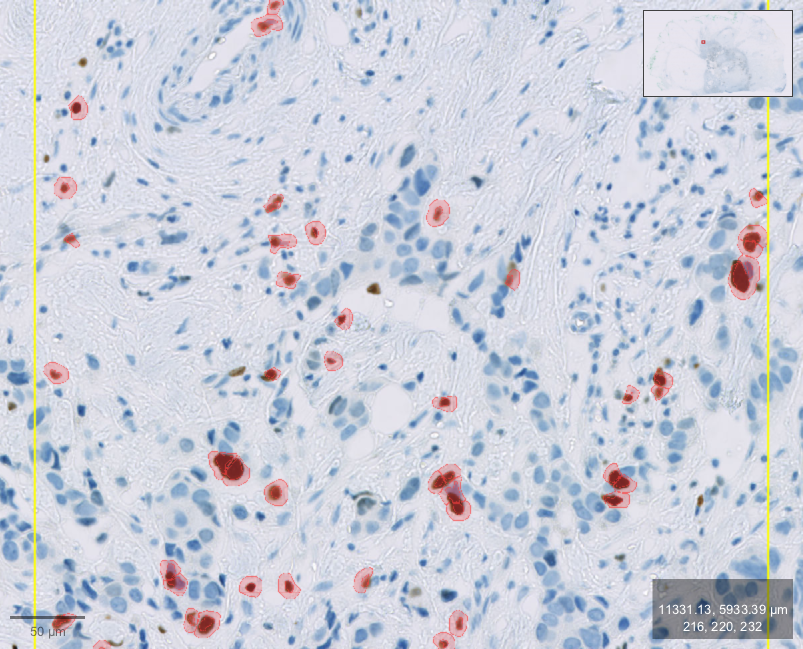

# Luma

**Make scientific software conversational.**

Luma is a native companion for QuPath, inspired by [Clicky](https://github.com/farzaa/clicky). It bridges a researcher's intent and the application's actual state through a reusable agent interface. The researcher keeps using the original scientific software.

Built for [Reinvent the Wheel: Tools for Science](https://luma.com/vdq0qw9u), 16–18 October 2026.



## Current prototype

- A compact bar at the top of the screen shows short status text. Expand it for conversation, measured results and action history. The companion follows the active QuPath image and selection.
- **33 implemented MCP tools** expose context, objects, measurements, navigation, display, highlights, analysis, recovery, live menus, JavaFX dialogs and reviewed Groovy execution.
- Actions execute immediately (`LUMA_APPROVALS=auto`, the default). Every data change is journaled and hierarchy changes get a checkpoint first, so "undo that" works. `LUMA_APPROVALS=review` restores human approval cards bound to the exact arguments and application state; the model never gets an approval tool.
- MCP discovery reflects the authenticated running gateway; a built update needs a normal reload before its new tools are available.
- Authored task guidance and the locally downloaded official QuPath documentation provide searchable application knowledge.
- A real public-slide fixture detected **899 cells**, classified **49** above a chosen DAB measurement threshold, compared results and restored the empty object hierarchy. An actual OpenAI agent also completed that fixed sequence in 21.5 seconds with five test-only simulated approvals; ordinary production actions still require human decisions. [Scientific agent evidence](docs/SCIENTIFIC-AGENT-TEST.md)

Those counts verify software operation for the fixture. They do not validate segmentation or biological interpretation. See [data provenance](docs/DATASETS.md).

**Voice is live and feels live.** Click the mic, talk, and QuPath moves. Amazon Transcribe hears you, the credit-checked OpenAI agent on Bedrock acts through the 33 tools, and a natural Polly voice answers. Simple view commands ("zoom in a little") run with no model round: spoken reply 0.4 s after you stop talking. Everything else gets an immediate spoken acknowledgment ("Zooming in.", "Ready for your approval.") while the action runs, then one short sentence with real numbers. Luma's own cursor flies to what it's talking about and outlines the matched cells or controls, Clicky-style. The full demo flow (region → detect 294 cells → classify 19 positive → "show me the positive cells") was driven by voice with human approvals on 17 October. Not GPT-Live; AWS credits only, with every request reserved against a $200 cap. [AWS speech](docs/AWS-SPEECH.md) · [Demo guide](docs/DEMO.md) · [Funding decision](docs/FUNDING.md)

## Start locally

Apple Silicon macOS, Xcode command-line tools, Node.js 22+, Git and Python 3.9+ are required.

```sh
python3 script/setup.py
./script/run-qupath.sh
./script/build_and_run.sh --verify
```

The bootstrap verifies pinned official downloads and keeps the JDK, QuPath, upstream source and documentation in `.local`. It installs nothing globally. The local QuPath launcher needs the full JDK because its stock runtime omits the extension's HTTP module.

QuPath's downloaded application and source remain unmodified. Luma uses a separate development launcher, Java extension, gateway and floating companion. Run `npm run verify:qupath` to compare the entire stock bundle with the verified package and check the launcher's specific additions. See [application preservation](docs/ARCHITECTURE.md#preserving-qupath).

Open an image in QuPath and select an object or region. Use Luma's quick actions, or connect an MCP client using the [setup guide](docs/SETUP.md). Risky actions appear in the companion for review.

## Understand and extend it

| Start here | Purpose |
|---|---|
| [Current readiness and safe next steps](docs/READINESS.md) | Verified results, loaded-build checks and remaining activation work |
| [Foreground demo](docs/LIVE-DEMO.md) | Compact bar, safe reload and real image-opening verification |
| [Product brief](docs/PRODUCT.md) | Problem, accepted direction and scope |
| [Setup](docs/SETUP.md) | Install, launch, MCP configuration and troubleshooting |
| [Tool reference](docs/TOOL-REFERENCE.md) | Current schemas, parameters and approval requirements |
| [Task coverage](docs/SOFTWARE-COVERAGE.md) | Import, analysis and navigation routes with proof boundaries |
| [Capability matrix](docs/CAPABILITIES.md) | Implemented, verified and blocked behavior |
| [Architecture](docs/ARCHITECTURE.md) | Process ownership and trust boundaries |
| [AWS text adapter](docs/AWS-TEXT.md) | Credit/access checks, conservative reserves and explicit model test |
| [API lookup](docs/API-LOOKUP.md) | Read-only pinned source retrieval for unfamiliar scripts |
| [AWS speech voice](docs/AWS-SPEECH.md) | Live route, guards, enable and verify commands |
| [Voice integration](docs/VOICE.md) | Implemented protocols, backend interface and remaining activation work |
| [Protocol](docs/PROTOCOL.md) | Requests, tool execution and approval semantics |
| [Contributor guide](docs/CONTRIBUTING.md) | Add adapters/tools and verify changes |
| [QuPath agent skill](skills/qupath/SKILL.md) | Scientific operating guidance and task references |
| [Demo guide](docs/DEMO.md) | Run the demonstration honestly |
| [Editable pitch deck](docs/pitch/README.md) | Seven slides with actual application evidence |
| [Review and verification](docs/REVIEW.md) | Commands, accepted fixes and proof boundaries |
| [Build journal](docs/BUILD-JOURNAL.md) | Decisions, evidence and outstanding work |

## Repository map

- `apps/companion/`: SwiftUI/AppKit floating interface, pointer and audio components.
- `packages/gateway/`: TypeScript tool validation, MCP, approvals, local events and knowledge.
- `adapters/qupath/`: Java 25 extension using the actual QuPath APIs.
- `skills/qupath/`: source-backed application guidance.
- `script/`: reproducible setup, build, launch, smoke and guarded fixture checks.
- `docs/`: architecture, evidence, contributor and pitch material.

`npm run doctor` checks local setup and connections without changing the application. `npm run check` runs focused tests, type checking and tool-reference consistency. `npm run smoke` exercises a real MCP client through the running gateway and QuPath without changing data. See the contributor guide before running real mutation fixtures.

Original project code retains the existing Apache-2.0 license. QuPath and the JDK retain their upstream licenses. This repository does not relicense upstream QuPath source. Public sample imagery has separate provenance in the dataset guide.
