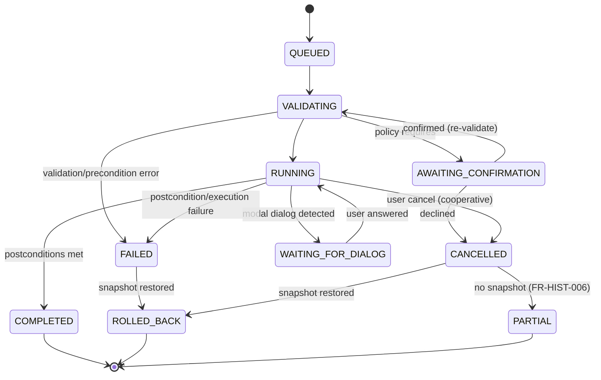

# D06 — Command and Operation Contract

## Executive Summary

This document specifies the typed contract that every input modality uses to operate on Fiji:

- `CommandSchema` (IF-04): generated from the runtime catalogue and the parameter table;
- `ActionRequest` (IF-01): the single request structure;
- validation and precondition rules;
- consequence classes and the confirmation policy;
- execution semantics: complete options, postconditions, outputs and side effects;
- the error codes;
- provenance fields.

It formalises A18's action model and ADR-004. These are design contracts with illustrative payloads; they are not implementation code.

## 1. CommandSchema (IF-04)

Generated by CMP-22 at start-up. Sources:

1. the runtime IJ1 command table (`Menus.getCommands()`), `ModuleService` and `ScriptService` (FR-CMD-002);
2. static enrichment from `docs/data/commands.csv` (framework, implementation, compatibility category inputs, `creates_new_image`, `preconditions`) and `docs/data/commands-core-parameters.csv` (keys, types, defaults, ranges, `consequential`, `native_unit`, `hidden_global_dependency`).

| Field | Type | Source column | Notes |
|---|---|---|---|
| `commandId` | string | `commands.csv.command_id` | Stable key, e.g. `ij1:Process>Filters>Gaussian Blur...` |
| `label` | string (exact, whitespace preserved) | `label` / runtime | FR-CMD-003 |
| `menuPath` | string | `menu_path` | FR-CMD-001 |
| `framework` | IJ1 \| IJ2 \| script \| macro-tool \| IJ1-tool | `framework` | Selects the route R1/R2/R4 |
| `implementation` | class or script path | `implementation`, `runtime_value` | Shadowing shown (FR-CMD-004) |
| `compatCategory` | C1–C6 \| S | A13 assignment (FR-CMD-005) | Evidence reference |
| `consequenceClass` | AC0–AC7 (default; may be refined at runtime from the target) | Assigned per A19 §3 | FR-CMD-005 |
| `routeHints` | `requires_macro_registration`, `uses_roi_manager`, `opens_window`, `headless_ok` | Catalogue flags (`headless_probe`, A08 notes) | D04 §2–4 |
| `preconditions` | list of predicates (§3) | `preconditions` | FR-PROC-004 |
| `createsNewImage` | yes \| no \| conditional | `creates_new_image` | Postconditions |
| `parameters[]` | list of `ParameterSchema` | `commands-core-parameters.csv` | Present for the 54 core commands. Commands without a schema are marked `schemaStatus=none`. |
| `postconditionFamily` | enum (§5) | Assigned per command | FR-PROC-005 |
| `cancellation` | cooperative-per-slice \| macro-abort \| none | A19 §1 | FR-PROC-013 |

`ParameterSchema`:

| Field | Meaning | Example (Gaussian Blur `sigma`) |
|---|---|---|
| `key` | Macro option key | `sigma` |
| `type` | number \| integer \| boolean-presence \| choice \| string \| image-ref \| path | number |
| `range` / `choices` | Validation domain, possibly depending on the target (e.g. threshold range per bit depth) | `>0` |
| `default` | The *documented* default. It is **never applied silently** for consequential parameters (FR-NL-003). | 2.0 |
| `defaultIsRemembered` | true if IJ1 remembers the last value in a static field | true (`GaussianBlur.java#L40`) |
| `consequential` | yes \| no | yes |
| `unit` | pixels \| calibrated \| conditional | pixels unless `scaled` |
| `hiddenGlobals` | Globals the command reads or writes | — |
| `source` | file#line at the pin | `GaussianBlur.java#L88` |

Illustrative schema (abridged):

```json
{
  "commandId": "ij1:Process>Filters>Gaussian Blur...",
  "label": "Gaussian Blur...",
  "framework": "IJ1",
  "compatCategory": "C3",
  "consequenceClass": "AC3",
  "routeHints": {"headless_ok": true},
  "preconditions": ["image.open"],
  "createsNewImage": "no",
  "postconditionFamily": "IN_PLACE_PIXELS",
  "cancellation": "cooperative-per-slice",
  "parameters": [
    {"key": "sigma", "type": "number", "range": ">0", "consequential": "yes",
     "unit": "pixels|calibrated-if-scaled", "defaultIsRemembered": true},
    {"key": "scaled", "type": "boolean-presence", "visibleWhen": "image.hasSpatialScale",
     "consequential": "yes"},
    {"key": "stack", "type": "boolean-presence", "visibleWhen": "image.stackSize>1",
     "consequential": "yes"}
  ]
}
```

## 2. ActionRequest (IF-01)

| Field | Type | Rules |
|---|---|---|
| `requestId` | UUID | Idempotency key (supplied by the client) |
| `origin` | MENU \| SEARCH \| SHORTCUT \| CANVAS \| PANEL \| NL_TYPED \| NL_SPOKEN \| MACRO \| REPLAY \| OBSERVED | Recorded (FR-HIST-001, CR-A25-11) |
| `kind` | COMMAND \| DIRECT \| SESSION \| CODE | A18 §1 |
| `commandId` | string | Required for COMMAND; must exist in the runtime catalogue (FR-CMD-003) |
| `operation` | enum | For DIRECT/SESSION: `SET_ROI`, `EDIT_ROI`, `ROI_LIST_*`, `SET_DISPLAY_RANGE`, `SET_LUT`, `SET_POSITION`, `SET_THRESHOLD_PREVIEW`, `OPEN`, `SAVE_AS`, `CLOSE`, `UNDO`, `REDO`, `CANCEL` |
| `params` | map key → typed value | **Complete**: every schema key, booleans explicit as true or false (FR-PROC-003) |
| `target` | `{docId, scope: {c?, z?, t?, allSlices?}, roiRef?}` | Explicit (FR-IMG-002). Inputs such as `image-ref` parameters also use `docId`s. |
| `consequenceClass` | AC0–AC7 | Computed by CMP-31 (may raise the class, e.g. AC3→AC4 when over budget) |
| `confirmationToken` | opaque | Required when policy demands it (§4) |
| `planRef` | `{planId, step}` | Set when the request came from an NL plan (D08) |
| `globalsOverride` | partial `GlobalsSnapshot` | Used for replay (FR-MEAS-001) |

Example: a typed NL instruction, after the user has confirmed it.

```json
{
  "requestId": "6c1f…",
  "origin": "NL_TYPED",
  "kind": "COMMAND",
  "commandId": "ij1:Process>Filters>Gaussian Blur...",
  "params": {"sigma": 2.0, "scaled": true, "stack": false},
  "target": {"docId": "doc-3", "scope": {"c": 2, "z": 5, "t": 1}},
  "consequenceClass": "AC3",
  "confirmationToken": "conf-…",
  "planRef": {"planId": "plan-17", "step": 1}
}
```

## 3. Validation and preconditions (FR-PROC-004, FR-NL-002)

The validation order is fixed. The first failure returns its error code.

| # | Check | Error code |
|---|---|---|
| 1 | Engine ready | `ENGINE_NOT_READY` |
| 2 | `commandId` exists in the runtime catalogue; the label resolves | `UNKNOWN_COMMAND` |
| 3 | The target `docId` exists and is open (except for SESSION/OPEN) | `PRECONDITION_FAILED` |
| 4 | Parameter completeness: every schema key is present, there are no unknown keys, and types and domains are valid. Domains may depend on the target (e.g. the threshold range of 16-bit versus 8-bit; FR-NL-002/CR-A17-13). | `VALIDATION_FAILED` |
| 5 | Preconditions: `image.open`, `image.type in {…}`, `image.binary`, `image.stack`, `roi.required`, `roi.area`, `threshold.set` (with a warning variant, FR-PROC-016), `multiImage.inputsDistinct` | `PRECONDITION_FAILED` |
| 6 | Mode support: the route is available in the engine mode (e.g. no M1 for `headless_ok=false`) | `UNSUPPORTED_IN_MODE` |
| 7 | Consequence policy (§4) satisfied | `CONFIRMATION_REQUIRED` / `CAPABILITY_CONFIRMATION_REQUIRED` |
| 8 | Snapshot budget, or AC4 confirmation present | `SNAPSHOT_BUDGET_EXCEEDED` |

For NL plans, validation runs twice: once at preview, and again immediately before execution (FR-NL-002). Any difference in the live-state snapshot between the two returns the plan for re-confirmation.

## 4. Consequence classes and confirmation policy

The class definitions are in A19 §3. The policy implements FR-NL-004, FR-MACRO-002, NFR-USE-001 and A19 §4.

| Class | MENU / SEARCH / SHORTCUT / CANVAS / PANEL | NL_TYPED / NL_SPOKEN | MACRO (user) | REPLAY |
|---|---|---|---|---|
| AC0 read-only | No confirmation | Auto-execute if unambiguous | n/a | Run |
| AC1 view | No confirmation | Auto-execute if unambiguous | n/a | Run |
| AC2 selection | No confirmation | Plan preview + confirm | n/a | Run |
| AC3 reversible data | No confirmation (undo available) | Plan preview + confirm | Covered by the macro's capability confirmation | Run with per-step snapshots |
| AC4 non-undoable data | Inline "cannot be undone" + confirm | Preview + explicit "cannot be undone" | Confirm once | Confirm once |
| AC5 globals | No confirmation; recorded with old and new values | Preview with the global highlighted + confirm | Recorded | Globals set at the start (shown in the preview) |
| AC6 persistent/external | Fiji-equivalent prompts (overwrite, save changes) | Preview with the target path + confirm | Confirm output locations | Confirm once |
| AC7 code | Capability confirmation per file hash | **Never generated** (FR-NL-007) | Capability confirmation | n/a |

## 5. Execution semantics

**Options string generation (R1).** Each parameter is serialised by type:

- number: `key=value`, in locale-independent decimal format;
- choice: `key=[value]`, always bracket-quoted;
- boolean-presence: `key` when true, omitted when false.

Omitting a boolean is the documented false (`GenericDialog.java#L1347-L1350`); the schema records that the key was considered. String and path values pass through the single escaping function (FR-MACRO-006).

The history stores the typed map. The macro string is derived from the map, never the reverse (ADR-003).

**Postcondition families (FR-PROC-005).**

| Family | Success requires | Typical commands |
|---|---|---|
| `IN_PLACE_PIXELS` | Target pixels changed (hash differs) or the change is legitimately none (flagged no-op); no new error log lines; no pending dialog | Filters, Invert, Math |
| `NEW_IMAGE` | Exactly the expected number of new `ImagePlus` IDs; registered as derived documents | Duplicate, Z Project, Image Calculator (create) |
| `RESULTS_ROWS` | System table rows increased by the expected count; rows copied to the document store | Measure, Summarize |
| `ROIS_ADDED` | ROI singleton count changed as expected; read back into the document set (D04 §4) | Add to Manager; Analyze Particles with `add` |
| `TYPE_CHANGE` | Bit depth or type changed to the requested value; display-scaling state recorded | Image › Type |
| `GLOBALS_ONLY` | Expected globals changed; recorded (AC5) | Set Measurements, Binary Options |
| `FILE_WRITTEN` | Output file exists and is non-empty; hash recorded; path is not an input (FR-IMG-009) | Save As, export |
| `DISPLAY_ONLY` | Pixel hash unchanged; display state changed | Set display range, LUT, threshold preview |

The postcondition outcome determines `COMPLETED` or `FAILED(POSTCONDITION_FAILED | EXECUTION_FAILED)`. `EXECUTION_FAILED` is used when error log lines or swallowed exceptions are detected (A08). Both trigger snapshot rollback (ADR-008).

**Side effects declared per command.** These are new images, results rows, ROI changes, globals written (from `hiddenGlobals`, e.g. Convert to Mask with stack `black` writes `Prefs.blackBackground` and restores it, `Thresholder.java#L100/L139`), windows opened (`opens_window`) and files written. Undeclared side effects found by the digest are recorded as *observed* and flagged for a schema update.

## 6. Operation lifecycle



## 7. Error codes (authoritative)

| Code | Meaning | Typical source | Recovery (D17) |
|---|---|---|---|
| `ENGINE_NOT_READY` | Engine is starting or has failed | Start-up | Wait or restart |
| `UNKNOWN_COMMAND` | `commandId` or label not in the runtime catalogue | Stale plan, removed plugin | Re-resolve |
| `VALIDATION_FAILED` | Parameter missing, unknown, wrong type or out of range | Any modality | Correct the parameters |
| `PRECONDITION_FAILED` | Target state unsuitable | Wrong type, no ROI, etc. | Explain; suggest the required state |
| `CONFIRMATION_REQUIRED` | Policy requires user confirmation | NL, AC4–AC6 | Show preview |
| `CAPABILITY_CONFIRMATION_REQUIRED` | User code contains capabilities needing consent | AC7 | Show the capability sheet |
| `DIALOG_PENDING` | A native dialog is waiting for the user | Commands without a schema; plugins | Bring the dialog forward |
| `EXECUTION_FAILED` | Error log lines or swallowed exception detected | Plugin exceptions | Roll back; show the log excerpt |
| `POSTCONDITION_FAILED` | Expected effects absent | Silent failures (A08) | Roll back; report |
| `CANCELLED` | User cancelled | Cancel or Esc | Roll back or partial |
| `PARTIAL_RESULT` | Cancelled or failed without a snapshot | AC4 | Mark the document partial |
| `TIMEOUT` | Watchdog limit exceeded without progress or dialog | Hung plugin | Cancel, or restart and replay |
| `ENGINE_LOST` | JVM terminated or worker dead | Crash, plugin exit | Replay recovery |
| `SNAPSHOT_BUDGET_EXCEEDED` | Snapshot would exceed the budget | Large data | Confirm AC4 |
| `IO_ERROR` | File read or write failure | IO | Report path (privacy-aware) |
| `UNSUPPORTED_IN_MODE` | Route not available in this engine mode | M1 batch | Use the GUI engine |

## 8. Provenance recorded per operation (FR-HIST-001, FR-IMG-004)

`actionId`, `requestId`, `origin`, `kind`, `commandId` and `label`, complete `params` and the derived options string, `target` (docId and input hashes), `globalsBefore`/`globalsDelta`, `roiGeometry` (float), `outcome` and error code, timings, `planRef` and transcript reference (for NL or speech), model identity (if an LLM was involved, FR-NL-011), engine `runtimeLockHash`, and the generated macro lines.

## Change log

- 2026-10-17: Initial version by the lead.
