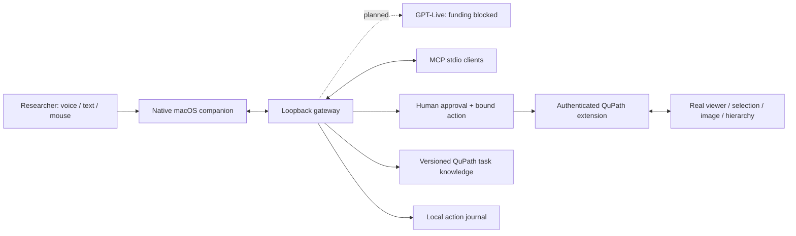

# Architecture

## Boundaries

The extension owns application state and runs JavaFX mutations on the UI thread. The gateway owns provider credentials, tool validation, approvals and conversation execution. The companion owns microphone capture, audio playback and presentation. MCP clients call the same tool executor as voice so validation and approval behavior cannot drift.

No arbitrary shell tool is exposed. General Groovy execution is available only as an explicit approval-gated escape hatch. QuPath plugins and scripts can access local files and run code; approval must show the exact source and be scoped to one invocation.

Only loopback interfaces are used. Per-install random tokens protect the bridge and gateway. Browser-origin requests are rejected. Secrets and image data stay out of Git. Structured observations are preferred to whole-screen capture; no unrelated application screenshot is sent by default.

## Preserving QuPath

The scientific application remains QuPath 0.7.0: its viewer, algorithms, projects, menus, plugins and scripting APIs. No upstream application source is patched. The official extracted app remains in `.local/qupath-package`; the separately named `dist/QuPathLuma.app` is a local development launcher. Its original application resources, including 165 top-level JARs and 16 nested documentation JARs, link to the official files, with one additional Luma extension JAR. The copied executable has the same code after normalizing its local signature. The launcher changes its own bundle name/identifier, adds the bridge classpath and isolates QuPath settings with its supported `qupath.prefs.name` property, using a separate per-checkout `science.luma/…/qupath/0.7` preference node. It uses the separate full JDK because QuPath's bundled runtime omits `jdk.httpserver`.

The gateway, model tools, approvals and floating interface live outside QuPath. Removing those layers leaves the downloaded stock application intact. QuPath operations can still change a researcher's active data when approved; preserving the application does not make every analysis or file operation reversible.

`npm run verify:qupath` verifies the pinned download SHA256, expands it into a temporary directory, compares every regular file, symlink and directory in the stock app, and checks its macOS signature. It then checks the separate launcher's original resource links and every classpath entry (including nested documentation), executable code, icon, exact configuration/metadata additions, isolated preferences and local full-JDK link, plus both clean pinned source/documentation checkouts. Exceptional Git index flags that could hide changes are refused. Executable-signature normalization happens only on temporary copies. The checker never repairs, resets, opens an image or restarts either app. A mismatch fails with inspection guidance. It currently verifies default bootstrap paths; custom `LUMA_QUPATH_APP` / `LUMA_JAVA_HOME` installations require their own trusted baseline.

The stock bundle's full signature and the launcher's copied executable signature are checked separately. External resource links prevent the development launcher from being a strictly sealed distributable macOS bundle; this is not a notarized installer or release package. This verifies installed artifacts, not loaded classes in an existing process, foreground UI behavior, audio or scientific validity. Follow the normal save/quit/rebuild/relaunch procedure to load adapter updates.

The first development launcher used `java.util.prefs.userRoot`, which macOS ignores. The current package uses QuPath’s own override instead. A running instance keeps its old preference node until normal restart. Earlier preference isolation was therefore not established, and existing user preferences have not been reset or repaired. Contract tests now use an entirely in-memory preference factory and verify that the real QuPath API honors the separate node. This isolates QuPath-managed settings; it is not a sandbox for arbitrary plugins or scripts.

## Provider and budget policy

The separate Realtime and GPT-Live transports and provider-injected backend are locally protocol-tested; see VOICE.md. Neither transport is constructed by the production server. A provider factory and native capture/playback wiring remain. Provider configuration is not proof of AWS credit eligibility. A verified local funding attestation, endpoint and hard session duration limit are required before opening a paid session. No automatic provider fallback can introduce cash billing.

The separate researcher-text route uses the implemented AWS-credit Bedrock adapter with the shared tool backend. Each request rechecks account/credit/access/pricing eligibility and retains a conservative attempt reservation. Its working text path does not establish funding or wiring for the GPT-Live audio frontend. See [AWS-TEXT.md](AWS-TEXT.md).

## Extensibility

Application adapters implement capability discovery, context observation and tool execution. QuPath-specific APIs remain in the adapter. Knowledge is Markdown with source references and version notes. Add a narrow structured operation before resorting to general scripting.

The native companion supervises a project-local Node child when no authenticated gateway is available. It reuses external development gateways and terminates only a child it owns. The launcher records the resolved Node executable in the local app bundle. No login item or system service is installed. Quitting the companion does not roll back or cancel QuPath work already underway.
