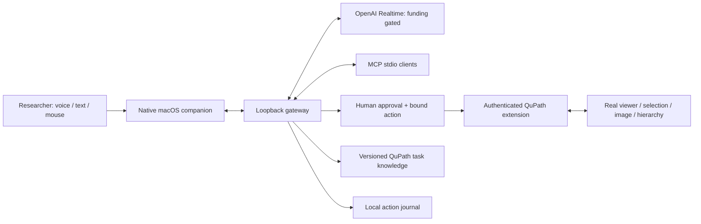

# Architecture

## Boundaries

The extension owns application state and runs JavaFX mutations on the UI thread. The gateway owns provider credentials, tool validation, approvals and conversation execution. The companion owns microphone capture, audio playback and presentation. MCP clients call the same tool executor as voice so validation and approval behavior cannot drift.

No arbitrary shell tool is exposed. General Groovy execution is available only as an explicit approval-gated escape hatch. QuPath plugins and scripts can access local files and run code; approval must show the exact source and be scoped to one invocation.

Only loopback interfaces are used. Per-install random tokens protect the bridge and gateway. Browser-origin requests are rejected. Secrets and image data stay out of Git. Structured observations are preferred to whole-screen capture; no unrelated application screenshot is sent by default.

## Provider and budget policy

Realtime uses OpenAI's documented protocol. Provider configuration is not proof of AWS credit eligibility. A verified local funding attestation, endpoint and hard session duration limit are required before opening a paid session. No automatic provider fallback can introduce cash billing.

## Extensibility

Application adapters implement capability discovery, context observation and tool execution. QuPath-specific APIs remain in the adapter. Knowledge is Markdown with source references and version notes. Add a narrow structured operation before resorting to general scripting.
