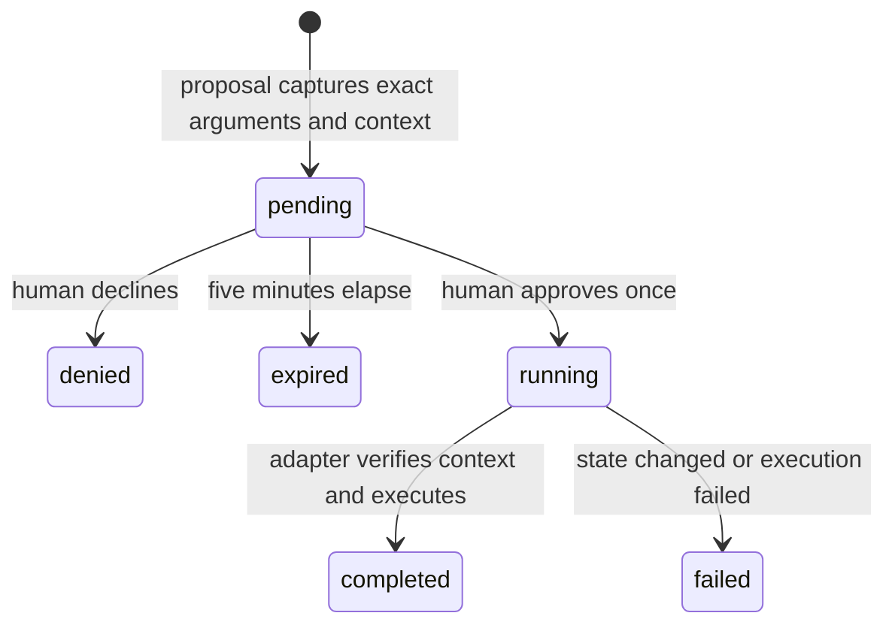

# Local protocol and adapter contract

## Processes

The Swift companion talks to the gateway on `127.0.0.1:49555`. The gateway talks to QuPath on `127.0.0.1:49556`. All requests use random per-install bearer tokens from `.local/state`. Browser Origin headers are rejected. Neither service exposes a network-wide listener or a CORS policy.

The MCP stdio process is a client of the existing gateway, not a second independent action runtime. A voice session, MCP client and companion therefore share approvals and action history.

## Gateway HTTP

| Method and route | Credential | Result |
|---|---|---|
| `GET /health` | Gateway or companion | Voice blocker, real QuPath context, recent actions, bridge error if unavailable |
| `GET /tools` | Gateway or companion | Current tool schemas and risk classes |
| `POST /tools/call` | Gateway or companion | `{name, arguments}` validated against the tool schema |
| `POST /approvals/:id` | Companion only | `{approved: boolean}` decides one pending action |
| WebSocket `/events` | Companion only | Connection, action and tool events; voice-start reports funding blocker |

The JSON request limit is 256 KiB. Unknown fields and invalid tool arguments fail schema validation. A model cannot attach an `approved` flag to tool arguments. MCP has no route for obtaining the companion token and no approval tool.

## Approval state machine



The executor claims an action before awaiting work, preventing duplicate approval clicks from executing it twice. Data/view operations use a shared serial queue. Approval compares the real image, selected IDs, hierarchy revision and z/t plane. Relevant image property changes also advance revision.

For JavaFX control actions, the proposal includes the window/control label and reviewed dialog fingerprint. Execution rejects changed control values, disabled or vanished targets and actions behind another modal dialog. A dispatched menu or button may still open a dialog, so the result explicitly does not claim completion.

A failed operation can have partial effects. Inspect QuPath and the checkpoint before retrying. Network timeouts do not prove the operation stopped.

## Bridge HTTP

Authenticated `POST /execute` accepts:

```json
{
  "operation": "focus",
  "arguments": {"x": 1000, "y": 1500, "downsample": 2},
  "expectedContext": "optional opaque observed context key"
}
```

Risky bridge calls require the gateway's approved invocation and expected context. The bridge is a trusted local component, not a sandbox against a malicious process that can read its token. General scripts execute with QuPath's local privileges.

The bridge reads and mutates JavaFX-owned state on the UI thread. Plugin detection uses QuPath's task runner. Modal menu/button actions dispatch after returning so HTTP completion does not deadlock on an open dialog. The JavaFX task has a 120-second wait limit. A queued task is cancelled when the wait expires, but an already-running task may still complete.

## Results and units

Coordinates refer to full-resolution image pixels with explicit image plane. Pointer results use JavaFX screen coordinates; the native overlay maps them to the matching macOS display. Smaller downsample means greater zoom.

A region scope tests object centroids inside the selected ROI on the same plane. List results contain an untruncated total and bounded rows. The measurement API returns raw named measurements and explicit non-finite markers rather than invented numeric values.

## New application adapter

Implement `Adapter.execute(operation, arguments, options)`. Start with observation, capability discovery, a reversible view action, and one scientifically useful operation. Keep application-specific APIs in the adapter. Add knowledge with version/source provenance. Reuse the gateway's validation, approvals and action events. Do not let a new voice provider or MCP transport invent a parallel approval path.

Detection is an exception to synchronous JavaFX dispatch: preparation and final observations run on JavaFX, while plugin orchestration runs on the request worker using a captured immutable list of approved parent objects. Other gateway mutations reject while detection is running. The native progress dialog provides cancellation. A client timeout can still leave an analysis running, so inspect that dialog before retrying. Detection results explicitly distinguish plugin execution from verified segmentation completion.
