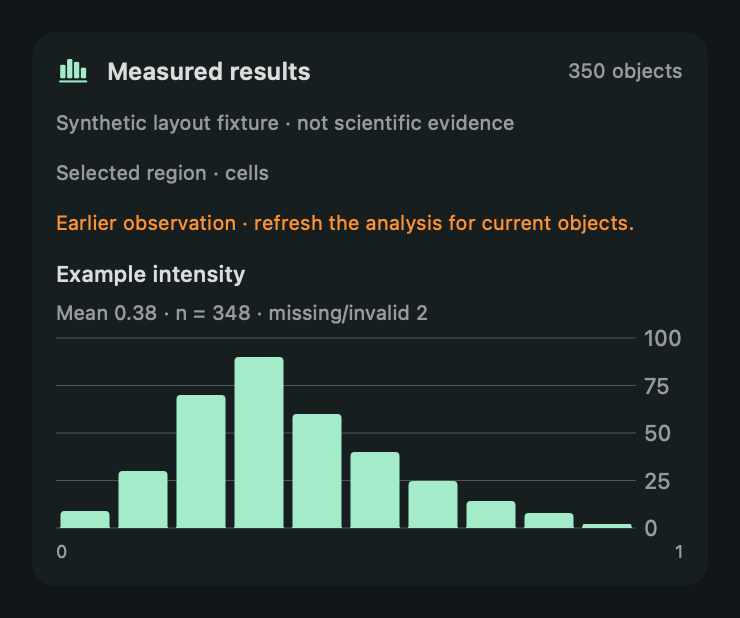

# QuPath task coverage

The target experience is an audience-selected task in the actual QuPath application: observe what is open/selected, choose a supported operation, act, then verify its visible or measured result. The interface combines 30 structured MCP tools with a live installed-command catalog and reviewed native-control/scripting fallbacks. A separate endpoint for every button would become stale as plugins and QuPath versions change; the live catalog and control observation supply that changing surface.

## Task routes

| Researcher intent | First route | Verification and boundary |
|---|---|---|
| “What am I looking at?” | context, viewer snapshot with a vision-capable client, selected objects | Metadata and actual object IDs; the configured AWS text model has no image vision |
| “Show this region / those positive cells” | focus, select, overlays | Actual viewer center/plane, exact class and full selection count |
| “Analyze these measurements” | analysis_catalog → measurement_summary | Full matching population, missing values, distribution plots and exact class groups; no automatic biological inference |
| “Find cells here” | analysis_catalog + knowledge → detect_cells | Selected annotations, current parameter units/choices, human approval, measured post-run results and contour inspection |
| “Import this slide / project” | open_path | Exact approved absolute local path, unsaved-change guard, native import/reader dialogs, actual resulting image/project |
| “Open the other image in this project” | project_images → open_project_image | Exact entry and observed source fingerprint; verify context after native dispatch |
| “Bring in these annotations” | inspect_import → import_annotations | Reviewed file hash, counts/classes, full-resolution pixel coordinates, valid original geometry/plane, native precision-change disclosure, unique IDs, checkpoint and actual imported count |
| “Open this analysis panel / click this button” | commands → run_command → ui → ui_action | Exact installed paths and current controls; review button/text/choice/tab action; inspect result, never assume dispatch completed |
| “Use a pixel/object classifier, TMA tool or extension” | knowledge + installed command discovery | Inspect actual project/model/plugin prerequisites; reviewed native interaction or exact-source script; specialized algorithms are not all individually pretested |
| “Export these results / run across the project” | native measurement exporter or documented reviewed script | Explicit destination/scope; native saved-data prerequisites; verify output; external files lie outside hierarchy recovery |
| “Compare / restore the earlier objects” | checkpoints, compare, restore | Exact image-bound checkpoint, full class/count changes; restore requires human review |

The current narrow GeoJSON importer supports a Feature, array or FeatureCollection of leaf annotations, max 16 MiB / 10,000 objects. It excludes archives, serialized `.qpdata`, detections and TMA grids. Other formats use documented native commands/scripts. Image opening supports existing local paths, not a remote connector or authenticated download. An external agent can use an authorized data connector to obtain a file first; Luma must not invent its location or coordinate system.

## Breadth evidence

The earlier real QuPath 0.7 discovery found 232 menu commands across File, Edit, Tools, View, Objects, TMA, Measure, Automate, Analyze, Classify, Extensions, Window and Help. Those counts depend on installed plugins and current application state. [The discovery record](pitch/capability-discovery.json) proves enumeration, not execution of all 232 commands.

The new increment adds seven tools: measurement_summary, analysis_catalog, project_images, open_path, open_project_image, inspect_import and import_annotations. Existing ui/ui_action now also expose exact choice-box options and enabled tab titles. Schemas and approval requirements are generated in [TOOL-REFERENCE.md](TOOL-REFERENCE.md).

## Fast, visible interaction

Use direct application APIs for common operations and numeric summaries. Full-scope statistics and histograms avoid hundreds of paginated model round trips. The companion plots two selected measurement distributions, with count/missing-value labels and a source-context marker. View changes return the actual screen target for the pointer overlay. Parsing GeoJSON and numeric summary calculations happen outside JavaFX after immutable observations are captured; applying imported objects occurs only after context/hash/geometry validation.

Keep the original QuPath application visible. Prefer a short action and visible change, then a short factual confirmation. Cold image loading and scientific algorithms can take time; show progress and preserve cancellation/review rather than claiming instant completion. Stop prevents future agent work; it does not terminate an already-running native plugin or undo completed actions.

The image above is a SwiftUI render from labeled synthetic values. It checks plot layout and earlier-observation labeling, not the foreground application flow.

## Verification state of this increment

- Compiled against the pinned actual QuPath 0.7 API.
- Synthetic real-library tests check full-population summaries, missing values, finite numeric extremes, import hash/identity/type/geometry rejection and duplicate UUIDs.
- Gateway tests check exact import/project preflight review, no execution before a human decision and changed-source rejection.
- Isolated JavaFX controls check selection fingerprints, choice/tab actions, disabled/ambiguous options and menu semantics without opening windows.
- Native result plots/import review compile; foreground layout and native file/import dialog flows remain to be verified after manual unlock and disposable-test authorization.

The previous real 899-cell analysis/recovery fixture and actual credit-funded text → viewer tests remain valid evidence for their stated operations. They do not prove the newly added import/navigation/plot paths. Live GPT-Live voice remains disabled by the credit-only funding requirement.

## Extending coverage

For a recurring task, add a narrow schema and real API operation, exact prerequisites, approval/target binding, observable outcome and focused failure tests. For an uncommon installed tool, discover its command and inspect its dialog; consult pinned docs/source before proposing a script. Record new task evidence in this matrix. Unsupported custom canvases, OS-owned dialogs, unavailable models and third-party plugin contracts should be exposed as concrete missing capabilities, not hidden behind a claimed universal tool.

Primary references: [QuPath command reference](https://qupath.readthedocs.io/en/0.7/docs/reference/commands.html), [measurement export](https://qupath.readthedocs.io/en/0.7/docs/tutorials/exporting_measurements.html), [scripting and project APIs](https://qupath.readthedocs.io/en/0.7/docs/scripting/overview.html), and the pinned source version in [script/dependencies.json](../script/dependencies.json).
