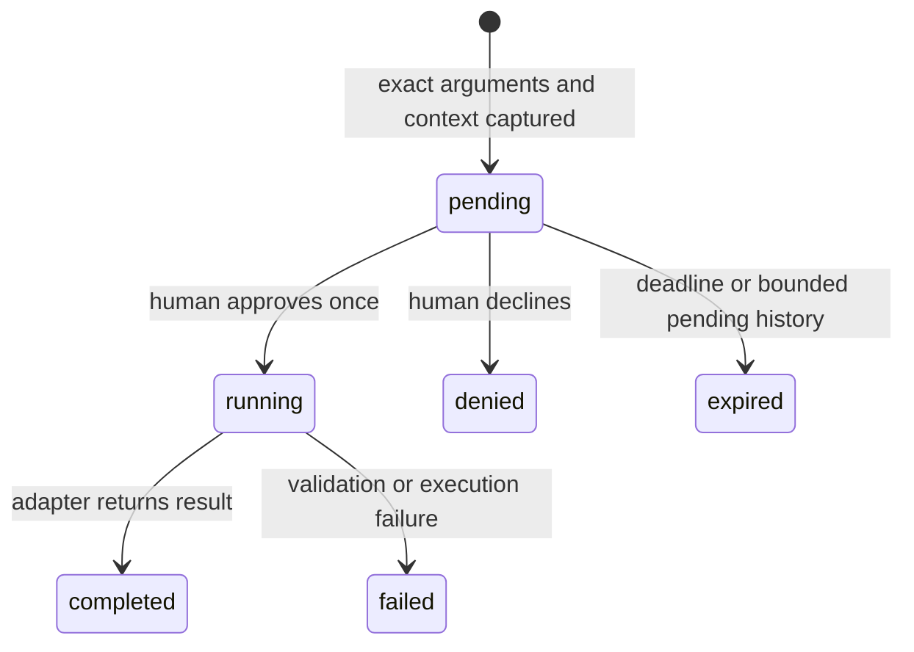

# Connect and operate the MCP

Use this with the [setup guide](../SETUP.md) and [protocol](../PROTOCOL.md). Commands below assume a deliberate development session; they are instructions, not permission to restart an existing research session.

## Connection

Install through the documented bootstrap, run the separate QuPath development launcher and native companion, then attach an MCP client. Local MCP operations require no model subscription, cloud resource or paid request. A provider-backed agent is a separate layer with the [funding policy](../FUNDING.md).

The MCP entry point is `packages/gateway/src/mcp.ts`, server name `luma-qupath`. It reads `LUMA_ROOT` (otherwise the working directory) to find this checkout's state/guidance. A desktop-client configuration is:

```json
{
  "mcpServers": {
    "luma-qupath": {
      "command": "node",
      "args": [
        "--import",
        "/ABSOLUTE/PATH/Voice/node_modules/tsx/dist/loader.mjs",
        "/ABSOLUTE/PATH/Voice/packages/gateway/src/mcp.ts"
      ],
      "env": { "LUMA_ROOT": "/ABSOLUTE/PATH/Voice" }
    }
  }
}
```

Replace all three checkout paths consistently. Node must be available to the desktop client's environment; use its absolute executable path if necessary. Each client owns its stdio MCP process. Running `npm run mcp` from the repository root is an alternative for clients that support launching that command.

| Interface | Default | Purpose | Credential |
|---|---|---|---|
| MCP | stdin/stdout | Tools, resource, prompt | Reads local gateway token internally |
| Gateway | `127.0.0.1:49555` | JSON HTTP and companion WebSocket | Gateway or companion token, route-dependent |
| Java adapter | `127.0.0.1:49556` | Health and native operation execution | Bridge token |

Port 49555 is **not** an MCP Streamable HTTP/SSE URL. Keep diagnostic logs off MCP stdout. The MCP process does not itself launch QuPath or the gateway.

## Discover before calling

1. Establish stdio transport and call `tools/list` using the MCP client SDK.
2. Use only the advertised names and schemas. Every discovery request reads the authenticated running gateway's catalog; it does not substitute the source registry on failure.
3. Call `qupath_context` to inspect actual image, selection and loaded adapter readiness.
4. Read `qupath://guide` or request prompt `qupath-researcher` for operating guidance. They have no execution side effect and do not confer approval.
5. If a required tool is absent or the adapter is stale, arrange a normal saved-work reload before proceeding. Reconnect clients that cache discovery.

Example SDK calls inside an already connected client:

```ts
const catalog = await client.listTools();
const observation = await client.callTool({
  name: 'qupath_context', arguments: {},
});
if (observation.isError) {
  // Surface the returned text; do not continue as if context was observed.
}
const guide = await client.readResource({ uri: 'qupath://guide' });
const prompt = await client.getPrompt({ name: 'qupath-researcher' });
```

This snippet does not create a model session or approve an operation. The source MCP uses the SDK `Client`/`StdioClientTransport` contract; see the actual [read-only smoke client](../../script/smoke.ts) for transport lifecycle and cleanup.

## Decode the response correctly

For most tools, a successful MCP `CallToolResult.content` contains a text block holding JSON. Parse only text you expect to be JSON; preserve non-JSON diagnostic text as an error. `qupath_snapshot` uses an image content block instead. Do not assume every response is a scalar string or every image is a completed analysis.

An example proposal shape, with illustrative values:

```json
{
  "status": "approval_required",
  "actionId": "ACTION_ID",
  "tool": "qupath_annotate",
  "arguments": { "x": 100, "y": 100, "width": 200, "height": 200 },
  "expiresAt": "2026-10-17T12:05:00.000Z",
  "message": "The researcher must review and approve this exact action in Luma. No execution has occurred."
}
```

The real proposal also carries observed image/target information where applicable. Store its exact `actionId`. Ask the researcher to review it in the companion, then read `qupath_action_status`. A conversation message such as “yes” is not an approval credential. There is no MCP approval tool, and adding an `approved` argument fails schema validation.

## Approval lifecycle



The gateway owns an immutable argument copy. Approval binds the current image/project identity, selected IDs, hierarchy revision, z/t plane and relevant image-property state through the opaque context key. UI actions also bind the observed control/dialog fingerprint; project navigation binds the entry fingerprint; imports bind file bytes and destination context. These checks refuse changed work rather than silently applying an old decision to new data.

Pending proposals normally expire after five minutes. The bounded store keeps at most 20 pending requests; older proposals can expire when that limit is exceeded. Terminal history is also pruned and is not a cross-restart database. The gateway claims a decision before awaiting work, so duplicate clicks do not execute twice. Calls that dispatch native work or analysis are not equivalent to idempotent reads.

`pending` means no approved execution; `running` means claimed, possibly queued; `completed` means the adapter returned, subject to the result's verification limits. `failed` may include partial effects. `denied` and `expired` do not execute that proposal. Never generalize a denial or expiry into permission to choose a different mutation.

Status reads, health observations and active backend waiting settle elapsed deadlines. They may append expiry metadata to the local journal but never approve or dispatch an application operation.

## Audit and uncertain outcomes

The local journal is `.local/state/actions.jsonl`. It records reviewed parameters, context and outcomes for reproducibility, and can contain private names, paths and approved script source. Keep it out of public commits/screenshots. It is not a QuPath project backup.

A human approval must be written before execution. If that audit write fails, the action fails explicitly with nothing executed. If execution already occurred and its terminal journal write fails, the gateway preserves the actual outcome with a separate `auditWarning`; it does not replay the operation or convert success into a fictitious failure. Persistence is then unconfirmed and the outcome is retained only in the running process.

Network timeouts and disconnects are uncertain outcomes. The JavaFX wait limit is 120 seconds: a task still queued can be cancelled, while one already running may complete. The MCP gateway call timeout is 130 seconds. Detection has native progress/cancellation and can leave partial results. Inspect status, actual context, progress/UI and checkpoints before considering a new request. Do not automatically retry a mutation because the transport returned an error.

## Credentials and trust

| Local file under `.local/state` | Holder/purpose | Must not be given to |
|---|---|---|
| `gateway-token` | MCP/tool clients; observation and proposals | Public logs, issues or remote pages |
| `companion-token` | Human-facing companion; can decide proposals | Model, MCP configuration or agent tool arguments |
| `bridge-token` | Trusted gateway-to-Java operations | Untrusted clients or published examples |

Tokens are generated locally with restrictive permissions. Keep the loopback services local. Origin-header rejection and host validation reduce browser exposure; they do not make malicious local code or a token-reading process harmless. Reviewed Groovy runs with local application privileges. No token-reset, bridge-direct-call or UI-automation technique should be used to evade a human approval.

## Troubleshooting

| Symptom | Inspect | Correct response |
|---|---|---|
| MCP cannot discover tools | Checkout paths, Node/tsx installation, gateway process and local state | Use setup/doctor; do not invent a source-only fallback catalog |
| Fewer tools than the source guide | Live `/tools` versus source registry | Save/quit/reload the appropriate project processes normally; reconnect cached clients |
| `adapterReadiness` requires restart | Loaded identity, completed manifest/JAR and declared operations | Rebuild if needed, save research work and normally restart; a rebuild alone does not reload Java |
| No image or missing project | Actual context | Open the requested data normally or through an approved opening proposal; scripting additionally needs a project |
| Region query is empty | Primary selected ROI, plane, existing objects | Re-observe and explain the actual scope; do not infer zero biology from a targeting error |
| Measurement missing | Exact catalog names, intended object kind and finite values | Choose an observed measurement with the researcher; do not guess aliases or replace missing with zero |
| Approval rejected as stale | Selection, image, revision, dialogs or changed file/entry | Re-observe, prepare a new exact proposal and obtain a new human decision |
| Dispatch returned but nothing completed | `ui`, `lastDispatch`, native dialogs and image/project metadata | Resolve the specific prompt and verify state; do not claim completion from acknowledgement |
| Action ID unknown after restart | Current image/hierarchy and local journal | Reconcile the observed outcome before a new mutation |
| Audit warning | Actual status/result and local storage | Preserve the outcome, fix storage separately, avoid automatic replay |
| Voice unavailable | Latest voice/funding readiness | Keep local MCP usable; never substitute an unapproved paid provider |

`npm run doctor`, `npm run docs:check` and the ordinary MCP smoke serve different purposes. The doctor diagnoses setup; the schema checker reads source artifacts; `npm run smoke` performs actual read-only MCP calls through the running gateway/QuPath. None is a full scientific or live microphone test. See [coverage](COVERAGE.md).
