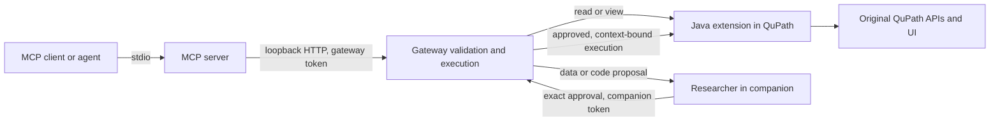

# QuPath MCP handbook

This handbook covers all **32 source-defined tools**, the resource, prompt, connection, approvals and verification boundaries. It is documentation only: it adds no endpoint or application behavior.

The handbook was checked against source snapshot `7e81707c478f57b1071062e4156ee395986a892a`. Later implementation work, especially voice activation, must be assessed using the latest [readiness](../READINESS.md) and [voice guide](../VOICE.md). Always discover the actual running catalog before planning a call.

| Guide | What it answers |
|---|---|
| [Tool guide](TOOLS.md) | What each tool does, an example, result interpretation and limits |
| [Workflows](WORKFLOWS.md) | How to combine tools for opening, navigation, analysis, imports and recovery |
| [Operations](OPERATIONS.md) | How to connect, handle proposals, interpret errors and diagnose mismatches |
| [Coverage](COVERAGE.md) | Which contracts and real-app evidence support each tool; how to maintain these docs |
| [Generated reference](../TOOL-REFERENCE.md) | Exact parameter tables, required fields and numeric/string limits |
| [Complete registry](../tool-schemas.json) | Every schema, description, operation ID and risk value in machine-readable form |

## Request path

The gateway handles four tools locally: `qupath_knowledge`, `qupath_api_search`, `qupath_api_read` and `qupath_action_status`. The remaining 28 map to Java operations. Local tools do not need a live image; the gateway must still be available. Most Java tools need an image, while context, menu/UI discovery and opening routes can operate without one where their prerequisites permit.

MCP uses **stdio**, not an HTTP MCP endpoint on port 49555. The gateway's HTTP/WebSocket API and the Java adapter's HTTP API are separate internal interfaces. See [connection details](OPERATIONS.md#connection).

## Authorization and results

| Risk | Execution | Examples |
|---|---|---|
| `read` | Immediate observation or local lookup | Context, measured values, source lookup |
| `view` | Immediate selection/display change | Focus, select, overlays |
| `data` | Human-review proposal first | Annotation, detection, classification, import, restore |
| `code` | Human-review proposal first; potentially external effects | Native opening, menus, UI controls, Groovy |

`qupath_checkpoint` is classified `read` but writes a bounded volatile recovery cache and can evict an older checkpoint. It needs no approval; MCP marks it non-read-only, non-idempotent and potentially destructive. Tool hints are descriptive metadata, not the permission boundary.

For data/code calls, a returned proposal is **not** a completed operation. Wait for the human decision, query `qupath_action_status`, then inspect the application's actual state. A completed action can still report `completionVerified: false` for a dispatched UI command or a detection plugin whose output needs inspection. Hierarchy recovery does not undo files, settings, arbitrary scripts or external effects.

## Complete tool index

Each link opens the practical guide. All names are exact; low-level Java operation IDs sometimes differ.

| Area | Tools |
|---|---|
| Observe | [context](TOOLS.md#qupath-context), [objects](TOOLS.md#qupath-objects), [measurements](TOOLS.md#qupath-measurements), [measurement_summary](TOOLS.md#qupath-measurement-summary), [analysis_catalog](TOOLS.md#qupath-analysis-catalog), [snapshot](TOOLS.md#qupath-snapshot) |
| Open and import | [project_images](TOOLS.md#qupath-project-images), [open_path](TOOLS.md#qupath-open-path), [open_project_image](TOOLS.md#qupath-open-project-image), [inspect_import](TOOLS.md#qupath-inspect-import), [import_annotations](TOOLS.md#qupath-import-annotations) |
| Navigate and display | [select](TOOLS.md#qupath-select), [focus](TOOLS.md#qupath-focus), [overlays](TOOLS.md#qupath-overlays) |
| Discover and operate UI | [commands](TOOLS.md#qupath-commands), [ui](TOOLS.md#qupath-ui), [ui_action](TOOLS.md#qupath-ui-action), [run_command](TOOLS.md#qupath-run-command) |
| Analyze | [annotate](TOOLS.md#qupath-annotate), [detect_cells](TOOLS.md#qupath-detect-cells), [classify](TOOLS.md#qupath-classify), [image_type](TOOLS.md#qupath-image-type) |
| Recover and compare | [checkpoint](TOOLS.md#qupath-checkpoint), [checkpoints](TOOLS.md#qupath-checkpoints), [compare](TOOLS.md#qupath-compare), [restore](TOOLS.md#qupath-restore), [delete_selected](TOOLS.md#qupath-delete-selected) |
| Extend and explain | [run_script](TOOLS.md#qupath-run-script), [knowledge](TOOLS.md#qupath-knowledge), [api_search](TOOLS.md#qupath-api-search), [api_read](TOOLS.md#qupath-api-read) |
| Follow execution | [action_status](TOOLS.md#qupath-action-status) |

The MCP resource `qupath://guide` and prompt `qupath-researcher` both expose the authored [scientific operating guide](../../skills/qupath/SKILL.md), with a warning that local guidance may describe a newer build. Neither executes a tool or changes approval policy.

## What broad coverage means

Structured tools cover common operations with explicit schemas. Live menu and JavaFX control discovery reach further installed capabilities. Reviewed Groovy and pinned API lookup provide an advanced route for other QuPath APIs. This is **not a dedicated, tested endpoint for every plugin, dialog or scientific task**. Native OS dialogs and arbitrary canvas controls are not universally addressable. Consult [per-tool evidence](COVERAGE.md) before claiming end-to-end coverage.
