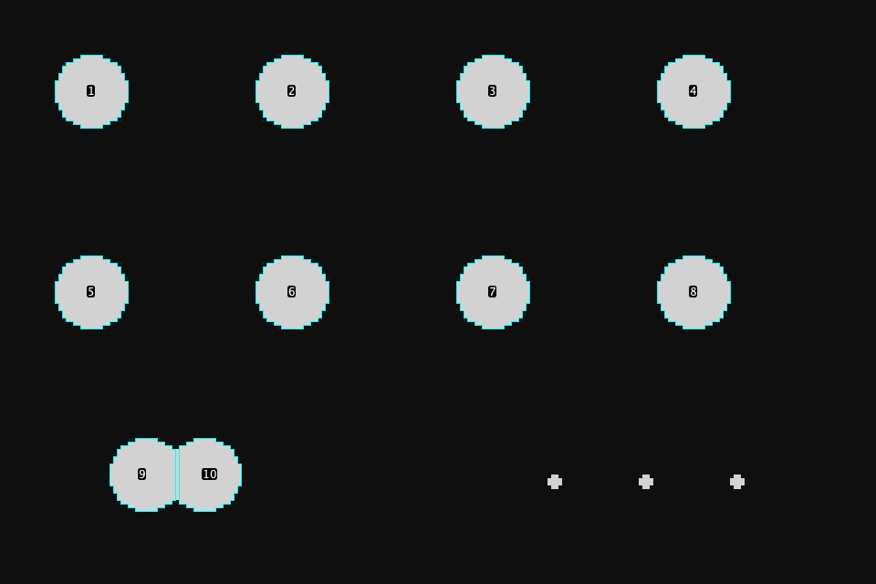

# Penny: corrected Fiji analysis by voice

Verified on 17 October 2026 using the installed Fiji in an isolated copy, a private authenticated gateway using the production Runtime and AWS credit guard, and three identical disposable 240 × 160 TIFF fields at 0.5 µm/pixel. The original interactive Fiji session was preserved.

## Real gateway conversation

`script/penny-fiji-smoke.ts` drives spoken-style text over the actual companion WebSocket and independently reads the active image, image-owned ROI Manager entries and object statistics after each turn. The first turn uses the real credit-checked model; deterministic follow-ups use the same Runtime without extra model calls.

| Request | Verified result | Reply time |
|---|---|---|
| Find nuclei without watershed and keep the small artifacts for now | 12 objects; explicit watershed/artifact arguments preserved | 3,312 ms; acknowledgment at 2,204 ms |
| Separate the touching cells | 1 clump separated; 13 objects | 22 ms; acknowledgment at 6 ms |
| Remove anything smaller than twenty square microns | 3 removed; 10 objects | 12 ms |
| Show me the size distribution | 10 objects; median 79 µm² | 42 ms |
| Apply this analysis to the entire folder | 3 images, each with 10 objects, no failed images | 158 ms; acknowledgment at 3 ms |

The complete recorded run took 5,837 ms including fixture opening and independent verification. Repeated runs in the same Fiji session also passed, including a fresh image starting with zero owned detections after folder replay. The pair was targeted with a known fixture selection before the split; this run does not prove physical pointing or microphone capture. Measurements and counts came from Fiji, not the model. Private sanitized evidence: `.local/evidence/penny-fiji-smoke-final-accepted.json` and `.local/evidence/penny-fiji-smoke-final-repeat.json`.



Generate the disposable fields using the compiled `PipelineContractTest --fixture /absolute/empty/folder`, then run:

```sh
LUMA_APP=fiji node --import tsx script/penny-fiji-smoke.ts \
  --authorized-aws-text --fixture-folder=/absolute/path/to/fixture
```

`LUMA_GATEWAY_PORT` can select an isolated loopback gateway. The script requires three identical TIFFs and checks 12 → 13 → 10 and 3 × 10, exact active image/calibration, task-attributed tools, arguments and actual per-image replay results. It writes only normal fixture macro/CSV outputs and private JSON evidence.

## Actual AWS speech path

Synthesized "How many cells are left?" was streamed as microphone PCM through the actual Transcribe → gateway → Fiji → Polly path. Transcript matched exactly; only context and object statistics ran; the reply was "10 objects." First reply audio arrived 1,139 ms after the input speech finished. A one-word "Brighter" request used only context and display, replying "Brighter." with first audio at 987 ms. These are individual observed timings, not percentile guarantees. This is a real provider/adapter test with synthetic audio, not a physical microphone or speaker listening test. No direct cash-billed route was enabled.

## Recovery and scope contracts

Additional real gateway checks counted one object in the visible top-left third, reported zero after removing all current-image detections, restored ten objects and the size cutoff with "Go back", and highlighted existing objects with "Show me the nuclei here". These follow-ups used no segmentation or model calls, even with another image's objects in the global manager.

Java contracts additionally verify selection/corner counts, empty populations, other-image preservation, observed-pointer expiry/image/plane binding, original nuclear-channel measurements, workflow parameters restored by undo, and matching live/folder counts and source-channel intensity (DAPI 210 versus unrelated active-channel 33). Saved folder workflows honour overrides (20 → 100 µm² and 0.000001 → 0.00002 mm²), preserve numeric precision, and restore the active plane and ROI after the real ROI Manager selection listener runs.

Folder replay applies generalisable parameters to full fields. Manual merges/deletions and source-only selections are disclosed as not replayed. Mixed-unit folder calibration conversion, biological validity and arbitrary-script recovery are outside this proof.

## Native experience

The compact bar displays a new live transcript ahead of old results, keeps Stop available during speech, clears stale feedback on interruption, and distinguishes failed results from successful ones. Fiji quick actions use Fiji tools; context uses the real image title and image-scoped object count. Offline Swift tests cover these state rules. Actual foreground appearance and hardware barge-in remain pending an unlocked Mac; echo cancellation is required for microphone barge-in while speaking (the plain-engine fallback mutes capture during playback).

Validation: the combined voice polish passes 220 gateway tests, 35 Swift tests, all seven Java contract suites, bridge build and signed native build. Speech-transport integration tests cover one-step image opening, model fallback, interruption during lookup and the human-review policy. Copied ROI entries retain their manager labels, names, plane bindings, properties and image ownership through segmentation, filtering, splitting, checkpoints and folder cleanup. The original running Fiji and companion were not restarted; the new native build is ready for foreground activation.
